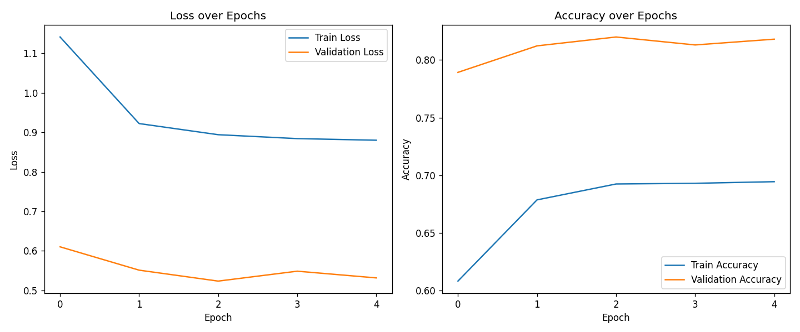

# CIFAR-10 Image Classification with MobileNetV2 - Documentation

This document provides a detailed explanation of the project, including the training process, inference script, and results.

## 1. Project Overview

This project implements an image classification model to classify images from the CIFAR-10 dataset. The model is built using transfer learning from a pre-trained MobileNetV2 model.

The project includes:
- A Jupyter Notebook (`train.ipynb`) to train the model.
- A Python script (`inference.py`) to perform inference on new images.
- The trained model saved as `cifar10_mobilenetv2.keras`.

## 2. Training the Model

The model is trained in the `train.ipynb` notebook. The notebook is structured as follows:

### 2.1. Training Code

The following code is extracted from the `train.ipynb` notebook.

```python
import tensorflow as tf
import matplotlib.pyplot as plt
import numpy as np
import os

# 1. Hyperparameters
batch_size = 64
epochs = 5
input_shape = (32, 32, 3)
# MobileNetV2 prefers larger inputs, so we will resize inside the model
resized_shape = (96, 96, 3)

# 2. Load and Prepare Data
print("Downloading and preparing CIFAR-10 data...")
(x_train, y_train), (x_test, y_test) = tf.keras.datasets.cifar10.load_data()

class_names = ['airplane', 'automobile', 'bird', 'cat', 'deer',
               'dog', 'frog', 'horse', 'ship', 'truck']

# 3. Data Augmentation Pipeline
# Building this into the model ensures it only runs during training (on the GPU if available)
data_augmentation = tf.keras.Sequential([
    tf.keras.layers.RandomFlip("horizontal"),
    tf.keras.layers.RandomRotation(0.1),
    tf.keras.layers.RandomZoom(0.1),
], name="data_augmentation")

# 4. Load Pretrained Model (Transfer Learning)
print("Loading pretrained MobileNetV2...")
base_model = tf.keras.applications.MobileNetV2(
    input_shape=resized_shape,
    include_top=False,
    weights='imagenet'
)

# Freeze the base model to only train the new classification head
base_model.trainable = False

# 5. Build the Final Model
inputs = tf.keras.Input(shape=input_shape)
# Apply augmentation
x = data_augmentation(inputs)
# Resize to fit MobileNetV2's minimum optimal size
x = tf.keras.layers.Resizing(96, 96)(x)
# MobileNetV2 specific preprocessing (scales pixels between -1 and 1)
x = tf.keras.applications.mobilenet_v2.preprocess_input(x)
# Pass through base model
x = base_model(x, training=False)
# Convert features to a single vector per image
x = tf.keras.layers.GlobalAveragePooling2D()(x)
# Add dropout for regularization
x = tf.keras.layers.Dropout(0.2)(x)
# Final output layer
outputs = tf.keras.layers.Dense(10, activation='softmax')(x)

model = tf.keras.Model(inputs, outputs)

# 6. Compile and Train
model.compile(optimizer=tf.keras.optimizers.Adam(learning_rate=0.001),
              loss='sparse_categorical_crossentropy',
              metrics=['accuracy'])

print("Starting training...")
history = model.fit(
    x_train, y_train,
    epochs=epochs,
    validation_data=(x_test, y_test),
    batch_size=batch_size
)

# 7. Evaluate Metrics
print("
Evaluating on test data...")
test_loss, test_acc = model.evaluate(x_test, y_test, verbose=2)
print(f"Final Test Accuracy: {test_acc*100:.2f}%")

# 8. Save the Model
save_path = 'cifar10_mobilenetv2.keras'
model.save(save_path)
print(f"Model saved to {save_path}")

# 9. Plotting Training Curves
plt.figure(figsize=(12, 5))

# Loss plot
plt.subplot(1, 2, 1)
plt.plot(history.history['loss'], label='Train Loss')
plt.plot(history.history['val_loss'], label='Validation Loss')
plt.title('Loss over Epochs')
plt.xlabel('Epoch')
plt.ylabel('Loss')
plt.legend()

# Accuracy plot
plt.subplot(1, 2, 2)
plt.plot(history.history['accuracy'], label='Train Accuracy')
plt.plot(history.history['val_accuracy'], label='Validation Accuracy')
plt.title('Accuracy over Epochs')
plt.xlabel('Epoch')
plt.ylabel('Accuracy')
plt.legend()

plt.tight_layout()
plt.savefig('training_curves.png')
print("Training curves saved to 'training_curves.png'.")
plt.show()

```

### 2.2. Training Results

The model was trained for 5 epochs (batch size 64, Adam, lr=0.001) with the MobileNetV2 base frozen.

| Epoch | Train Acc | Train Loss | Val Acc | Val Loss |
|-------|-----------|------------|---------|----------|
| 1 | 60.81% | 1.1415 | 78.93% | 0.6102 |
| 2 | 67.86% | 0.9223 | 81.23% | 0.5511 |
| 3 | 69.24% | 0.8941 | 82.00% | 0.5234 |
| 4 | 69.30% | 0.8842 | 81.31% | 0.5485 |
| 5 | 69.44% | 0.8801 | 81.81% | 0.5315 |

**Final test accuracy: 81.81%** (test loss 0.5315).

Validation accuracy is higher than training accuracy. This is expected here: training metrics are computed *with* data augmentation (flip, rotation, zoom) and dropout active, while validation runs without them. Validation accuracy plateaus around epoch 3, so the frozen-base model has largely converged; further gains would come from fine-tuning the top MobileNetV2 layers at a lower learning rate or using a larger input size.

The curves are saved as `training_curves.png`.



### 2.3. Detailed Evaluation

Overall accuracy is not enough to see which classes the model confuses (cats vs. dogs is the usual weak spot on CIFAR-10). Run either the final cell of `train.ipynb` or:

```bash
python evaluate.py
```

This prints per-class precision, recall and F1, and writes `metrics.txt` and `confusion_matrix.png`.

## 3. Inference

The `inference.py` script is used to predict the class of a single image using the trained model.

### 3.1. Inference Code

```python
"""Predict the CIFAR-10 class of a single image using the trained MobileNetV2 model.

Usage:
    python inference.py --image_path OIP.jpg
    python inference.py --image_path photo.png --model_path cifar10_mobilenetv2.keras --top_k 3
"""
import argparse
import os
import sys

import numpy as np
import tensorflow as tf
from PIL import Image

CLASS_NAMES = ['airplane', 'automobile', 'bird', 'cat', 'deer',
               'dog', 'frog', 'horse', 'ship', 'truck']


def load_image(image_path):
    """Load an image as a (1, 32, 32, 3) float32 array.

    The model resizes to 96x96 and applies MobileNetV2 preprocessing internally,
    so only the CIFAR-10 sized input (raw 0-255 pixels) is prepared here.
    """
    img = Image.open(image_path).convert('RGB').resize((32, 32))
    return np.expand_dims(np.array(img, dtype=np.float32), axis=0)


def predict_image(image_path, model_path='cifar10_mobilenetv2.keras', top_k=3):
    if not os.path.exists(model_path):
        sys.exit(f"Model file '{model_path}' not found. Run train.ipynb first.")
    if not os.path.exists(image_path):
        sys.exit(f"Image '{image_path}' not found.")

    model = tf.keras.models.load_model(model_path)
    probs = model.predict(load_image(image_path), verbose=0)[0]

    best = int(np.argmax(probs))
    print(f"Image: {image_path}")
    print(f"Predicted Class: {CLASS_NAMES[best]}")
    print(f"Confidence: {probs[best] * 100:.2f}%")

    if top_k > 1:
        print(f"\nTop {top_k} predictions:")
        for i in np.argsort(probs)[::-1][:top_k]:
            print(f"  {CLASS_NAMES[i]:<11} {probs[i] * 100:6.2f}%")
    return CLASS_NAMES[best], float(probs[best])


if __name__ == "__main__":
    parser = argparse.ArgumentParser(description="CIFAR-10 image classifier (MobileNetV2)")
    parser.add_argument('--image_path', default='OIP.jpg', help='Path to the image to classify')
    parser.add_argument('--model_path', default='cifar10_mobilenetv2.keras', help='Path to the saved model')
    parser.add_argument('--top_k', type=int, default=3, help='Number of top predictions to show')
    args = parser.parse_args()
    predict_image(args.image_path, args.model_path, args.top_k)
```

### 3.2. Example Inference

Here is an example of running the inference script on the `OIP.jpg` image.


**Command:**
```bash
python inference.py --image_path OIP.jpg
```

Optional arguments: `--model_path` (default `cifar10_mobilenetv2.keras`) and `--top_k` (default 3).

**Output format:**
```
Image: OIP.jpg
Predicted Class: <class>
Confidence: <score>%

Top 3 predictions:
  <class>  <score>%
  ...
```
The sample image shows a sailing ship on the sea, so the expected class is `ship`. Exact confidence depends on the trained weights.

## 4. Setup

```bash
pip install -r requirements.txt
jupyter notebook train.ipynb   # trains, saves cifar10_mobilenetv2.keras, plots curves
python run_all.py              # evaluation + sample inference; fills results into this doc
python inference.py --image_path OIP.jpg
```
